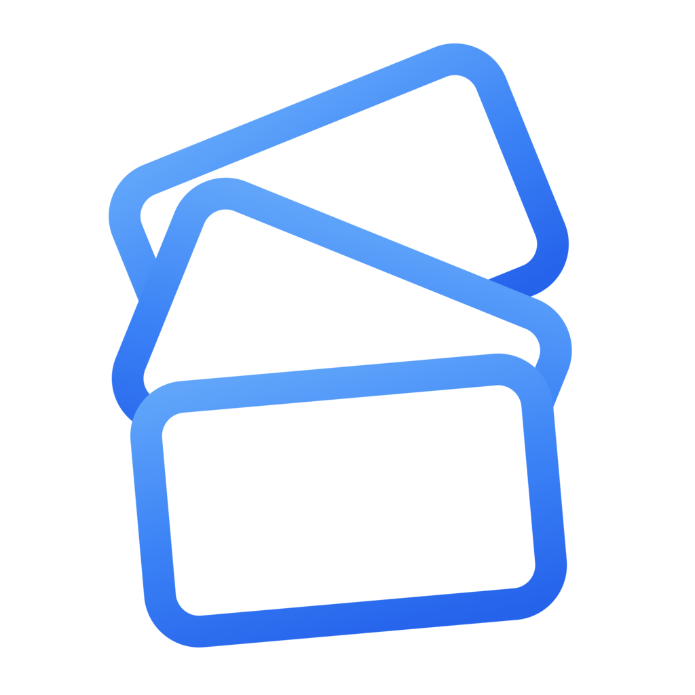
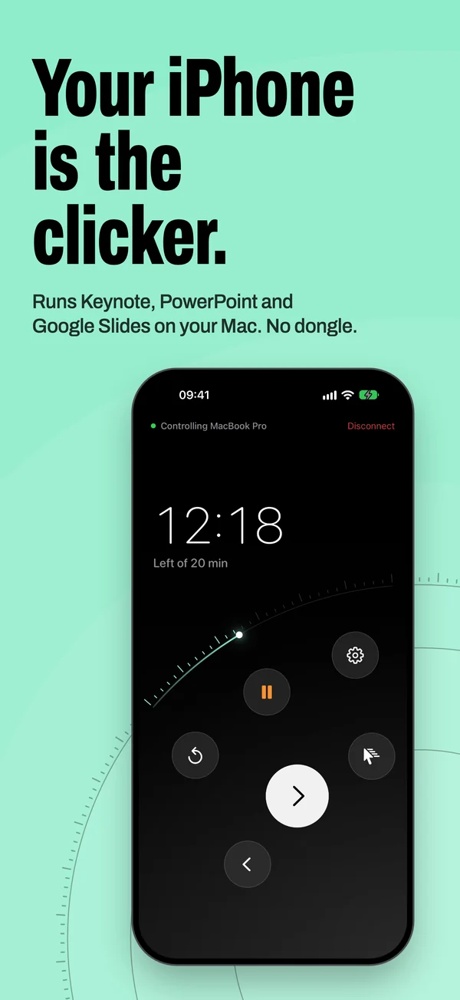
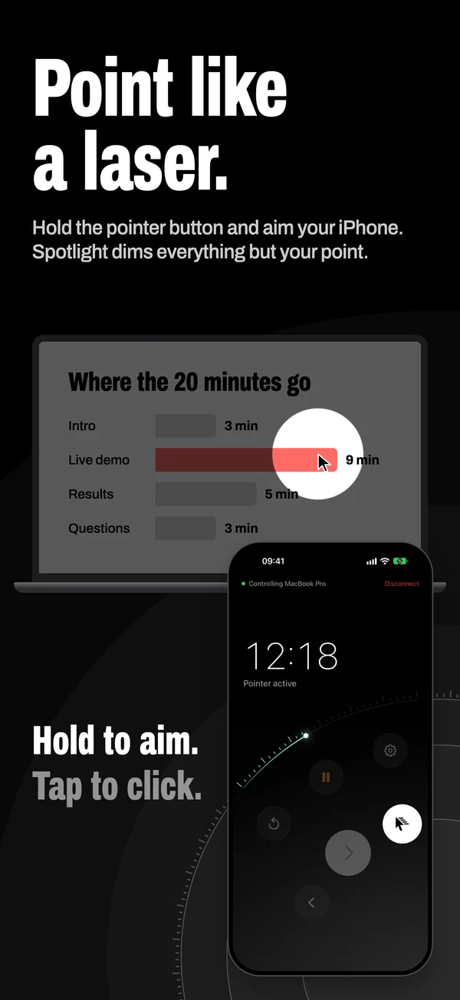
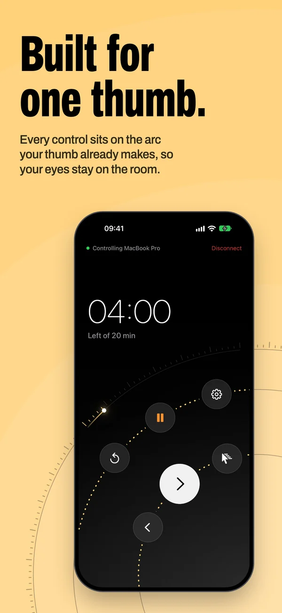
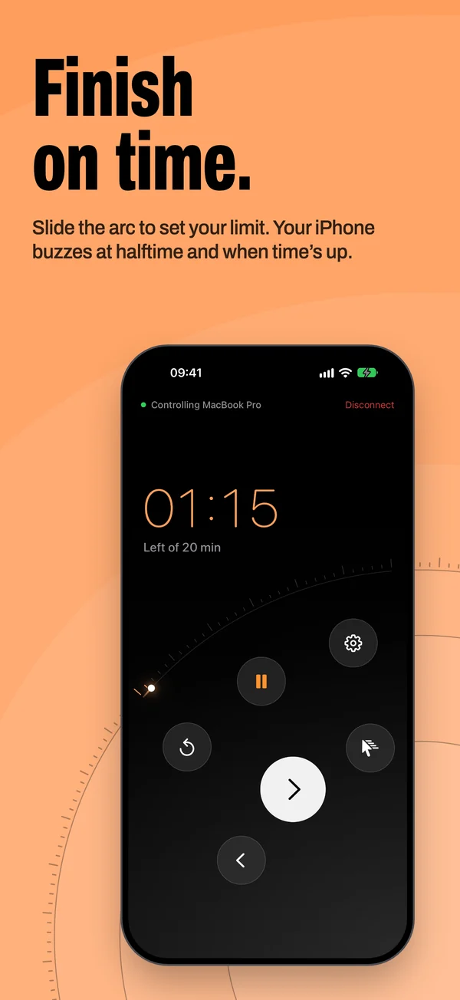
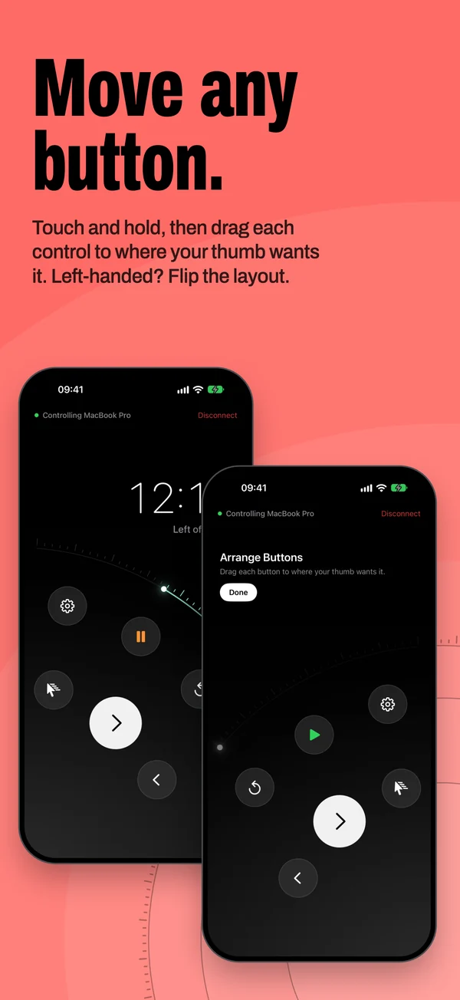
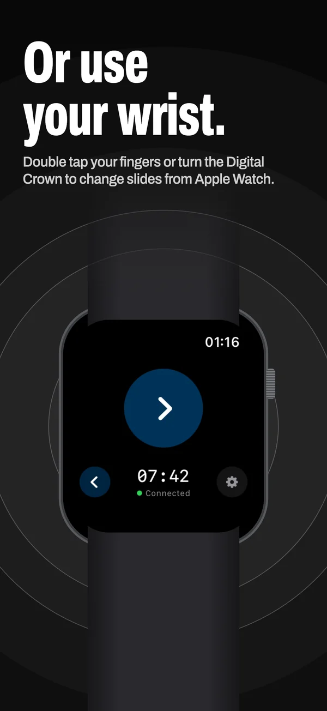
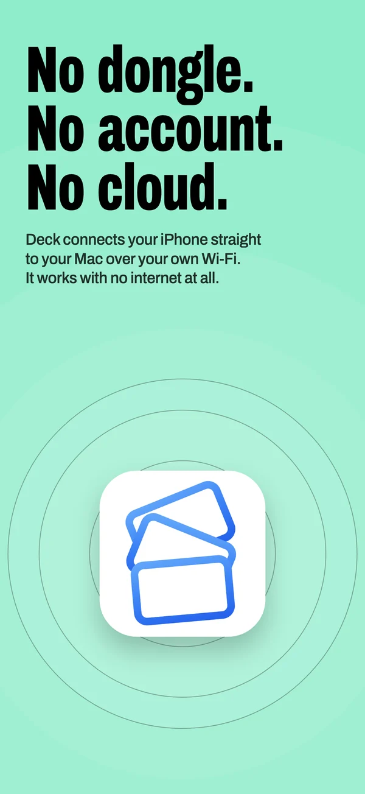
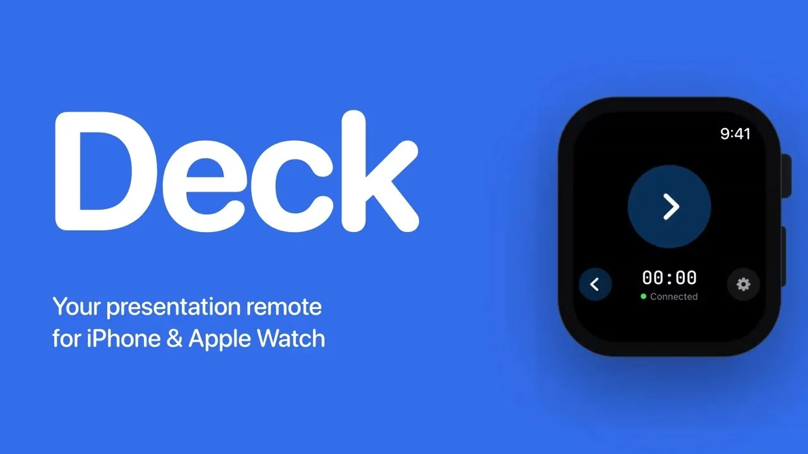
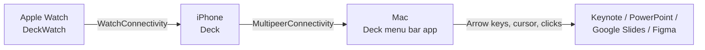

<p align="center">
  <a href="https://deck.dou.so"></a>
</p>

<h1 align="center">Deck: your iPhone is the clicker</h1>

<p align="center">
  <strong>A presentation remote for iPhone and Apple Watch.<br>Runs Keynote, PowerPoint and Google Slides on your Mac. No dongle.</strong>
</p>

<p align="center">
  <a href="https://apps.apple.com/us/app/deck/id6758130180"></a>
  <a href="https://github.com/douinc/deck/releases/latest"></a>
  <a href="https://deck.dou.so"></a>
  <a href="https://deck.dou.so/support"></a>
  <a href="LICENSE"></a>
</p>

<p align="center">
  
  
  
  
</p>
<p align="center">
  
  
  
</p>

---

## Watch it run a talk

Thirty seconds. Every slide change in the film comes from a real tap, double tap or wrist flick.

<p align="center">
  <a href="https://youtu.be/bQY4ZfCDE-s"></a>
</p>

---

## Two installs, then present

### 1. Install Deck on your Mac

It sits in the menu bar and presses the arrow keys for you. It is free and open source.

```bash
brew tap douinc/tap
brew install --cask deck
```

No Homebrew? [Download the DMG](https://github.com/douinc/deck/releases/latest), open it, and drag Deck to Applications. If Homebrew calls the tap untrusted, run `brew trust douinc/tap` once.

The first time Deck opens, a short setup guide asks you to allow it under **System Settings → Privacy & Security → Accessibility**. Deck reopens by itself once you turn the switch on.

### 2. Install Deck on your iPhone

[Download Deck on the App Store](https://apps.apple.com/us/app/deck/id6758130180). The Apple Watch app comes with it.

7-day free trial, then $19.99 a year.

### 3. Open both and tap your Mac

Your iPhone finds the Mac on the same Wi‑Fi. Tap **Allow** when your iPhone asks to find devices on your local network, then tap your Mac's name. Deck then drives whatever app is in front: Keynote, PowerPoint, Google Slides, Figma, a PDF viewer.

Needs macOS 14, iOS 18 and watchOS 10 or later. Mac not showing up? [Get help](https://deck.dou.so/support).

---

## What it does

### On iPhone

| | |
|---|---|
| **Built for one thumb** | Next, Previous and the pointer sit on the arc your thumb already makes. Timer and settings are one stretch further out. |
| **Finish on time** | Slide the timer arc to set a limit of up to 30 minutes. The readout counts down, shifts from mint to amber to orange as time runs out, then turns coral and counts the overrun. |
| **Haptic pacing** | Your iPhone buzzes at an interval you choose (30 seconds to 10 minutes), three times at halftime, and with one long buzz when time's up. |
| **Point like a laser** | Hold the pointer button and aim your iPhone to move the Mac's cursor. Tap it to click. |
| **Spotlight** | Optionally dims the Mac's screen around the cursor while you hold, so the room follows your point. |
| **Move any button** | Touch and hold a button, then drag each control to where your thumb wants it. |
| **Left or right hand** | Flip the whole layout for the hand that holds the phone. |
| **Click to advance** | Next can send a left click instead of the right arrow, for slides and apps that advance on click. |
| **Lock Screen timer** | The countdown also shows on your Lock Screen and in the Dynamic Island. |
| **Stays awake** | The screen stays on while the remote is open, and the app reconnects to your Mac on its own if the link drops. |

### On Apple Watch

| | |
|---|---|
| **Tap** | A large Next button and a smaller Previous button. |
| **Double tap** | Tap your index finger and thumb together twice for the next slide. Needs Apple Watch Series 9 or later, or Ultra 2, on watchOS 11, with your wrist raised. |
| **Wrist flick** | Flick forward for next, backward for previous. Options: a 3-second gesture lock, forward-only "No Going Back", inverted directions, and auto-toggle with wrist raise. |
| **Digital Crown** | One click of the Crown moves one slide. The direction can be inverted. |
| **Timer** | Tap the time to start or pause. Press and hold to reset. |

### On Mac

| | |
|---|---|
| **Menu bar app** | No Dock icon. The menu shows whether it is waiting, connected or paused, and the last command it received. |
| **One-click fixes** | If Accessibility or Local Network access is missing, the menu says so and opens the right pane in System Settings. |
| **Setup guide** | Walks through the Accessibility permission and connecting your iPhone, with a QR code for the App Store. Reopen it from the menu any time. |
| **Launch at login** | Optional, in Settings. |

---

## How it works



The Mac advertises itself on the local network and the iPhone browses for it. Slide commands and pointer movement travel straight from iPhone to Mac. The Mac turns them into key presses and mouse events for whichever app is in front. The Apple Watch talks to the iPhone, which relays its commands.

---

## No dongle. No account. No cloud.

Deck connects your iPhone straight to your Mac over your own Wi‑Fi. It works with no internet at all.

- No sign-up and no account
- No analytics and no tracking
- Nothing about your slides is read, stored or sent anywhere
- The one network request Deck makes outside your Wi‑Fi: the Mac app asks GitHub once a day whether a newer version exists

Read the [Privacy Policy](https://deck.dou.so/PRIVACY_POLICY.html) and the [Terms of Service](https://deck.dou.so/TERMS_OF_SERVICE.html).

---

## Troubleshooting

| Problem | What to check |
|---|---|
| iPhone can't find the Mac | Deck is open on the Mac (icon in the menu bar) and not paused. Both devices are on the same Wi‑Fi. Local Network is on for Deck on the iPhone (Settings → Deck) and on the Mac (System Settings → Privacy & Security → Local Network, macOS 15 or later). |
| Hotel, school or office Wi‑Fi | These networks often block devices from seeing each other. Turn on Personal Hotspot on your iPhone and join it from your Mac. |
| Using a VPN | Turn it off on both devices while presenting. |
| Connected, but slides don't change | Click the Deck icon in the Mac menu bar. If it shows a warning, click the Fix item and allow Deck under Accessibility. Then click your slideshow once so it is in front. |
| Watch says Disconnected | The watch works through your iPhone. Open Deck on the iPhone and connect to your Mac first. |

More answers on the [support page](https://deck.dou.so/support) and in the wiki's [Troubleshooting](https://github.com/douinc/deck/wiki/Troubleshooting) page. Still stuck? Email [team@dou.so](mailto:team@dou.so) or [open an issue](https://github.com/douinc/deck/issues).

---

## Build from source

<details>
<summary>Developer instructions</summary>

### Prerequisites

- macOS 14 or later with Xcode 16 or later
- [XcodeGen](https://github.com/yonaskolb/XcodeGen) and [just](https://github.com/casey/just): `brew install xcodegen just`

### Build

```bash
git clone https://github.com/douinc/deck.git
cd deck
just generate     # Create Deck.xcodeproj from project.yml
just run-mac      # Build and open the Mac app
just run-sim      # Build and run the iPhone app in the simulator
```

Run `just` to list every command. To build with your own Apple Developer team, replace `HD35YQ72U4` in `project.yml` and run `just generate` again.

### Project structure

```
deck/
├── MacApp/              # macOS menu bar app
├── iPhoneApp/           # iOS remote
├── WatchApp/            # watchOS companion
├── LiveActivityWidget/  # Lock Screen and Dynamic Island timer
├── Shared/              # Wire protocol and Local Network checks
├── wiki/                # Developer documentation (synced to the GitHub wiki)
├── index.html           # Landing page (deck.dou.so)
├── support/             # Support page (deck.dou.so/support)
├── marketing/appstore/  # App Store panels and their renderer
├── video/               # The 30-second film
├── public/              # Logos, web captures and README images
├── project.yml          # XcodeGen configuration
└── justfile             # Build and release commands
```

### Documentation

The [wiki](https://github.com/douinc/deck/wiki) covers the [architecture](https://github.com/douinc/deck/wiki/Architecture), the [wire protocol and key classes](https://github.com/douinc/deck/wiki/API-Reference), and [building and releasing](https://github.com/douinc/deck/wiki/Building).

</details>

---

## Contributing

Contributions are welcome. Read [Contributing](https://github.com/douinc/deck/wiki/Contributing), fork, create a branch, and open a pull request.

---

## License

MIT License. See [LICENSE](LICENSE).

<p align="center">
  Made by <a href="https://github.com/douinc">DOU Inc.</a>
</p>
