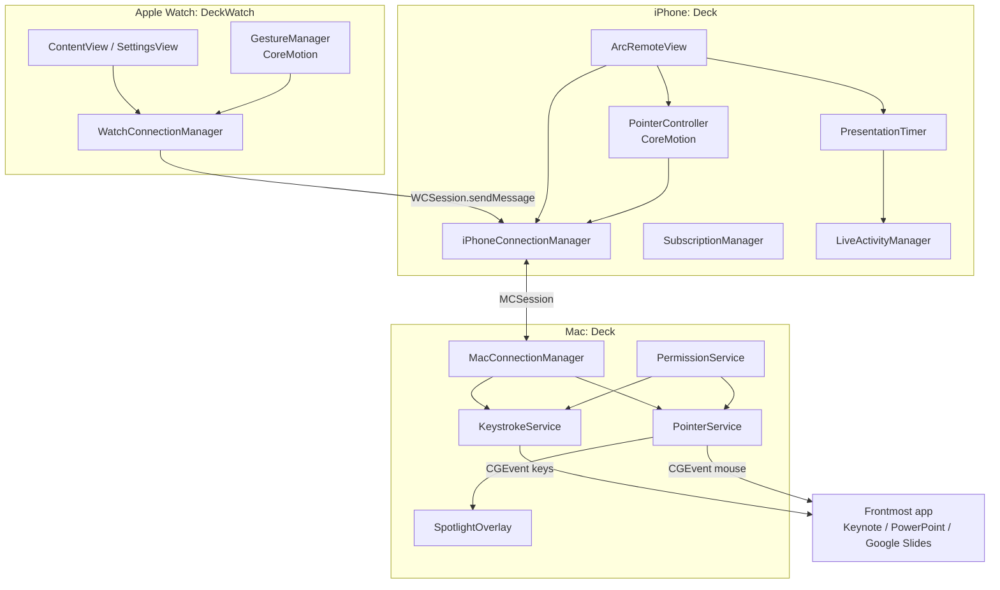
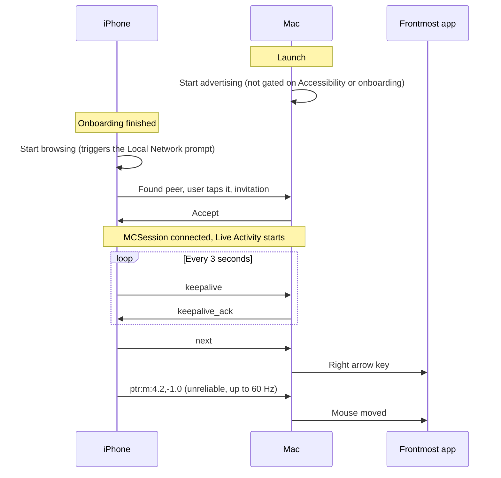
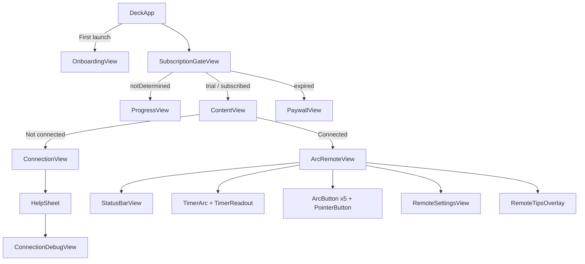
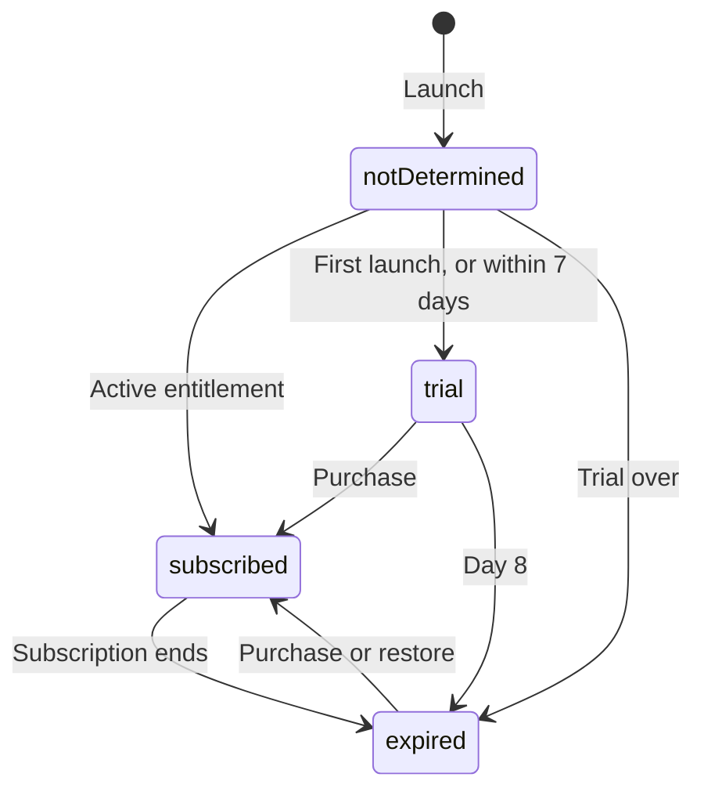

# Architecture

Deck is three apps with no server. The iPhone talks to the Mac over MultipeerConnectivity, and the Apple Watch talks to the iPhone over WatchConnectivity.

## System overview



## Discovery and connection

Both sides use the service type `clickerremote` (`_clickerremote._tcp` and `_clickerremote._udp` in each Info.plist).

- **Mac** advertises with `MCNearbyServiceAdvertiser` and accepts every invitation.
- **iPhone** browses with `MCNearbyServiceBrowser` and invites the Mac the user taps, with a 15-second timeout.
- Sessions use `encryptionPreference: .optional`.
- Each device persists one `MCPeerID` in UserDefaults (`RemoteServiceConfig.persistentPeerID`). A fresh peer ID with the same name counts as a different peer and produces phantom duplicates.



### Keeping the link healthy

MultipeerConnectivity can report `.connected` long after the path is dead, and Bonjour state goes stale across sleep, backgrounding and permission prompts. Deck handles each case explicitly:

| Mechanism | Where | Behavior |
|-----------|-------|----------|
| Keepalive | iPhone | Sends `keepalive` every 3 s; the Mac answers `keepalive_ack` |
| Watchdog | Both | No inbound packet for 15 s tears the session down for a clean reconnect |
| Auto-reconnect | iPhone | Reconnects to the last Mac by name with backoff of 1, 2, 4, 8 s plus jitter. An explicit Disconnect clears it. |
| Invite guard | iPhone | Prevents overlapping invitations to the same Mac |
| Browser refresh | iPhone | Recreates the browser every 12 s while no Mac is visible, and whenever the app becomes active |
| Wake restart | Mac | Restarts the advertiser on `NSWorkspace.didWakeNotification` |
| Pause | Mac | "Pause Deck" stops advertising and is never undone automatically |

### Local Network permission

MultipeerConnectivity gives no signal when Local Network access is denied; discovery simply finds nothing. `LocalNetworkPermissionMonitor` (in `Shared/`) runs a Bonjour `NWBrowser` for the same service type and watches for `kDNSServiceErr_PolicyDenied` (-65570). It can only detect a denial, never confirm a grant.

- On iPhone a denial shows the "Deck can't look for your Mac" card with a button to Settings.
- On Mac (macOS 15+) a denial shows a "Fix" item in the menu and a warning in the setup guide.

The iPhone delays browsing until onboarding ends so the system prompt appears right after the page that explains it.

## Wire protocol

Messages are UTF-8 strings sent over the `MCSession` data channel. There are two families, both defined in `Shared/RemoteCommand.swift`.

### Commands

The raw value of a `RemoteCommand`, sent `.reliable`:

| String | Case | Mac action |
|--------|------|------------|
| `next` | `nextSlide` | Right arrow (key code 124) |
| `previous` | `previousSlide` | Left arrow (123) |
| `start` | `startPresentation` | Return (36) |
| `end` | `endPresentation` | Escape (53) |
| `black` | `blackScreen` | B (11) |
| `keepalive` | `keepalive` | None; replies `keepalive_ack` |
| `keepalive_ack` | `keepaliveAck` | None |

The current remote only sends `next`, `previous` and `keepalive`. `start`, `end` and `black` are understood by the Mac but have no button.

### Pointer messages

`ptr:`-prefixed strings, parsed by `PointerMessage`:

| String | Meaning | Delivery |
|--------|---------|----------|
| `ptr:m:<dx>,<dy>` | Relative cursor motion in points, y growing downward | `.unreliable` |
| `ptr:click` | Left click at the cursor | `.reliable` |
| `ptr:spot:1` / `ptr:spot:0` | Spotlight on / off | `.reliable` |

A Mac build that predates the pointer fails to decode these as a `RemoteCommand` and drops them, so a new iPhone build still works with an old Mac, minus the pointer.

## iPhone app

### View hierarchy



### Arc layout

`ArcLayout` places everything on circles around a pivot just outside the bottom corner on the holding side, roughly where the base of the thumb rests.

| Ring | Radius (× unit) | Holds |
|------|-----------------|-------|
| Inner | 0.70 | Previous (23°), Next (49°), Pointer (75°) |
| Outer | 1.08 | Reset timer (39°), Start/Pause (58°), Settings (77°) |
| Timer | outer + (outer − inner) / φ ≈ 1.315 | Timer arc with one tick per minute |
| Readout | one more golden step out | Time and caption |

`unit` is the screen width, capped at 55% of the height so the arcs fit short screens. Angles are measured at the pivot from the bottom edge. Switching `Handedness` mirrors the pivot to the other corner.

Custom button positions are stored normalized (distance from the pivot in units, x across and y up), so a saved layout mirrors with the holding hand and scales to other screen sizes.

The landing page (`index.html`) and App Store panels (`marketing/appstore/rings.js`) redraw the same rings from these constants. Change them in all three places together.

### Timer

`PresentationTimer` ticks once a second and owns the haptics: an interval pulse, three pulses at the halfway point, a long buzz at the limit, and two pulses every 30 seconds of overrun. `TimerTint` maps progress to the four colors (mint under 75%, amber from 75%, orange from 90%, coral when over).

`TimerArc` doubles as the limit picker. Dragging along it while stopped sets 0 to 30 minutes; hit testing is disabled while the timer runs.

Every state change is pushed to `LiveActivityManager`, which updates the `DeckLiveActivity` widget extension on the Lock Screen and Dynamic Island. The Live Activity starts when a Mac connects and ends on disconnect.

### Pointer

`PointerController` turns the phone into an air mouse while the pointer button is held.

- A press shorter than 0.18 s is a click. Motion is ignored until the press is clearly a hold, so a click never nudges the cursor.
- Device motion is sampled at 60 Hz. Horizontal motion is rotation about the world's vertical axis (rotation rate projected onto gravity), so it works whether the phone is held flat or upright. Vertical motion is rotation about the horizontal axis perpendicular to the phone's long edge.
- Rates are smoothed, passed through a small deadzone to hide tremor, and scaled by `1800 × sensitivity` points per radian.
- With Spotlight on, `spot:1` is re-sent twice a second as a heartbeat.

### Subscription



`SubscriptionManager` (StoreKit 2, `@Observable`) checks the product's subscription status, falls back to `Transaction.currentEntitlements`, then falls back to `TrialTracker`. The trial start date is stored in the Keychain so it survives reinstalling. `PaywallView` wraps Apple's `SubscriptionStoreView`.

### State management

| State | Type | Scope |
|-------|------|-------|
| Connection | `iPhoneConnectionManager` (`ObservableObject`) | App |
| Timer | `PresentationTimer` (`ObservableObject`) | App |
| Subscription | `SubscriptionManager` (`@Observable`) | Environment |
| Pointer | `PointerController` (`ObservableObject`) | `ArcRemoteView` |
| Preferences | `@AppStorage` | Per view |

## Mac app

### Structure

`DeckMacApp` declares a `MenuBarExtra` and a `Settings` scene. `LSUIElement: true` keeps it out of the Dock. `AppCoordinator` owns the services and view models:

| Type | Role |
|------|------|
| `MacConnectionManager` | Advertising, session, watchdog, Local Network probe |
| `KeystrokeService` | Key down and key up `CGEvent`s for a `RemoteCommand` |
| `PointerService` | Mouse-moved and click `CGEvent`s; carries sub-point remainders; keeps the cursor on a display |
| `SpotlightOverlay` | Click-through dimming windows on every display with a hole at the cursor |
| `PermissionService` | Accessibility status, prompt, polling |
| `AppRelauncher` | Quits and reopens Deck |
| `UpdateChecker` | Asks the GitHub releases API for a newer tag at most once a day |
| `PreferencesManager` | Onboarding state, debug menu, launch at login (`SMAppService`) |
| `MenuBarViewModel`, `WelcomeViewModel` | UI state for the menu and the setup guide |

### Launch sequence

1. Check Accessibility and schedule the update check.
2. Start advertising immediately. Discovery is never gated on Accessibility or on finishing the setup guide; Accessibility only decides whether received commands become input events.
3. If Accessibility is off, poll for it once a second.
4. When it flips on, relaunch after 1.5 s. macOS only applies a new Accessibility grant to a fresh process.
5. Show the setup guide if onboarding is incomplete, skipping past the permission step after an automatic relaunch.

### Input injection

Key and mouse events are posted to `.cghidEventTap` from a `.hidSystemState` source, so they reach whichever app is frontmost. Both need Accessibility permission. The Spotlight overlay does not: "off" must always get through.

`SpotlightOverlay` builds one borderless window per screen at the shielding window level, so it sits above full-screen slideshows. The dim is 65% black with a hole 13% of the display height in radius, redrawn at 60 Hz. If no pointer traffic arrives for 2 seconds it hides itself, so a dropped connection cannot leave the screen dimmed.

## Apple Watch app

### Relay

```
Watch → WCSession.sendMessage → iPhone → MCSession → Mac
```

`WatchConnectionManager` sends `["command": "next"]`. The iPhone relays it as a `RemoteCommand` and replies with `connectedToMac`. The iPhone also pushes `connectedToMac` through `updateApplicationContext` whenever its connection changes. A command that fails is retried up to 3 times at 0.5 s intervals.

The watch has no direct path to the Mac, and Local Network privacy does not apply to it.

### Input methods

| Method | Implementation |
|--------|----------------|
| Buttons | Plain SwiftUI buttons |
| Double tap | `.handGestureShortcut(.primaryAction)` on the Next button (watchOS 11+). In Wrist Flick mode the shortcut moves to the flick on/off toggle. |
| Wrist flick | `GestureManager` reads `rotationRate.x` at 50 Hz. Above 3.0 rad/s triggers, with a 0.8 s cooldown or a 3 s lock. |
| Digital Crown | `.digitalCrownRotation`; each whole detent sends one command |

`ExtendedSessionManager` holds a `WKExtendedRuntimeSession` (`self-care` background mode) so the app stays in front during a talk, and starts a new session when one expires.

The watch timer is local to the watch and independent of the iPhone's timer.

## Threading

MultipeerConnectivity and WatchConnectivity deliver delegate callbacks on background queues. The connection managers hop to the main queue before touching `@Published` state. `SubscriptionManager` is `@MainActor`. `GestureManager` processes motion on its own serial queue and publishes on the main queue.
