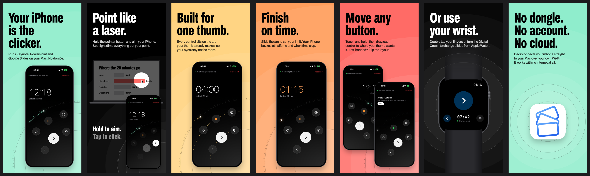
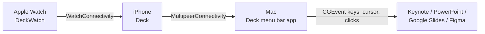

# Deck Wiki

Deck turns an iPhone and Apple Watch into a presentation remote for a Mac. This wiki documents how the three apps work, how to build and release them, and how to fix common problems.



## Quick links

| Page | What it covers |
|------|----------------|
| [[User-Guide]] | Every control on iPhone, Apple Watch and Mac |
| [[Troubleshooting]] | Connection, slide control, watch, subscription and build problems |
| [[Getting-Started]] | Set up a development environment |
| [[Architecture]] | How the apps find each other and what travels between them |
| [[API-Reference]] | Wire protocol, key classes, stored settings, identifiers |
| [[Building]] | Build commands, releases, Homebrew cask, marketing assets |
| [[Contributing]] | Workflow and code style |
| [[Feature-Ideas]] | What has shipped and what could come next |

## The three apps

| App | Platform | Version | Role |
|-----|----------|---------|------|
| Deck | iOS 18+ | 2.0.0 | The remote: slide control, pointer, timer |
| DeckWatch | watchOS 10+ | 2.0.0 | Wrist control, relayed through the iPhone |
| Deck | macOS 14+ | 2.0.0 | Menu bar receiver that presses keys and moves the cursor |



## What is in 2.0

- **Thumb-arc remote.** Controls sit on arcs around the thumb of the holding hand, for the left or right hand.
- **Pointer.** Hold a button and aim the iPhone to move the Mac's cursor; tap to click. Spotlight can dim the Mac's screen around the cursor.
- **Arrangeable buttons.** Touch and hold, then drag any control to a new spot.
- **Timer arc.** Slide along the arc to set a limit; the bar drains as the talk counts down.
- **Guided setup.** Onboarding on iPhone, a setup guide on Mac, first-run tips on Apple Watch, and automatic detection of a denied Local Network permission.

## Tech stack

| Component | Technology |
|-----------|------------|
| Language | Swift 5.9 |
| UI | SwiftUI |
| iPhone ↔ Mac | MultipeerConnectivity |
| Watch ↔ iPhone | WatchConnectivity |
| Mac input | Core Graphics `CGEvent` |
| Motion | CoreMotion (iPhone pointer, watch wrist flick) |
| Purchases | StoreKit 2 |
| Lock Screen timer | ActivityKit + WidgetKit |
| Build | XcodeGen + xcodebuild, driven by `just` |

## Repository structure

```
deck/
├── MacApp/              # macOS menu bar app
├── iPhoneApp/           # iOS remote
├── WatchApp/            # watchOS companion
├── LiveActivityWidget/  # Lock Screen and Dynamic Island timer
├── Shared/              # RemoteCommand, PointerMessage, LocalNetworkPermission
├── wiki/                # Source of this wiki
├── index.html           # Landing page (deck.dou.so)
├── support/             # Support page (deck.dou.so/support)
├── marketing/appstore/  # App Store panels and their renderer
├── video/               # The 30-second film
├── public/              # Logos, web captures, README images
├── project.yml          # XcodeGen configuration
└── justfile             # Build and release commands
```

## Distribution

| App | Channel | Link |
|-----|---------|------|
| Deck for iPhone and Apple Watch | App Store | [apps.apple.com](https://apps.apple.com/us/app/deck/id6758130180) |
| Deck for Mac | Homebrew cask | `brew tap douinc/tap && brew install --cask deck` |
| Deck for Mac | Signed and notarized DMG | [GitHub Releases](https://github.com/douinc/deck/releases/latest) |

The iPhone app has a 7-day free trial, then costs $19.99 a year. The Mac app is free.

## Links

- Website: [deck.dou.so](https://deck.dou.so)
- Support: [deck.dou.so/support](https://deck.dou.so/support)
- Film: [youtu.be/bQY4ZfCDE-s](https://youtu.be/bQY4ZfCDE-s)
- License: [MIT](https://github.com/douinc/deck/blob/main/LICENSE)

---

*Maintained by [DOU Inc.](https://github.com/douinc)*
