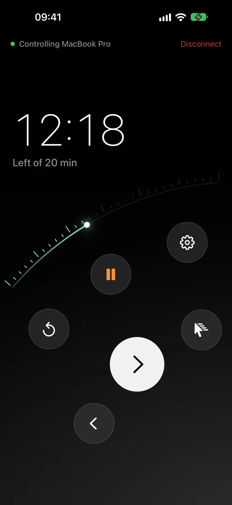
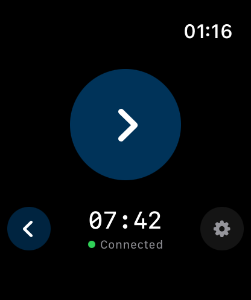

# User Guide

How to set Deck up and what every control does. For problems, see [[Troubleshooting]].

## Set up

1. **Install Deck on your Mac.** `brew tap douinc/tap && brew install --cask deck`, or download the DMG from [GitHub Releases](https://github.com/douinc/deck/releases/latest).
2. **Open Deck on the Mac.** A setup guide opens. It asks you to turn on Deck under System Settings → Privacy & Security → Accessibility. Deck reopens by itself once the switch is on.
3. **Install Deck on your iPhone** from the [App Store](https://apps.apple.com/us/app/deck/id6758130180). The Mac setup guide shows a QR code for it. The Apple Watch app installs with it.
4. **Open Deck on the iPhone.** After three intro pages, tap **Allow** when iOS asks to find devices on your local network.
5. **Tap your Mac's name.** Both devices must be on the same Wi‑Fi, or the Mac on the iPhone's Personal Hotspot.
6. **Start your slideshow on the Mac** and click on it once so it is in front. Deck controls whichever app is frontmost.

Requirements: macOS 14, iOS 18, watchOS 10 or later. No internet connection is needed.

## iPhone remote

The remote is laid out on arcs around the thumb of the hand holding the phone.

| Control | Where | What it does |
|---------|-------|--------------|
| **Next** | Inner arc, large white button | Next slide (right arrow key) |
| **Previous** | Inner arc | Previous slide (left arrow key) |
| **Pointer** | Inner arc | Hold and aim to move the Mac's cursor. Tap to click. |
| **Reset timer** | Outer arc | Sets the timer back to zero |
| **Start / Pause timer** | Outer arc | Green play when stopped, orange pause when running |
| **Settings** | Outer arc | Opens the settings sheet |
| **Timer arc** | Outside the buttons | Shows remaining time. Slide along it to set a limit. |
| **Disconnect** | Top right | Disconnects from the Mac after a confirmation |

The first time you connect, a tips card explains these controls.

### Timer

- **Set a limit:** with the timer stopped, slide your thumb along the timer arc. It moves in 1-minute steps up to 30 minutes. Slide to zero for no limit. Presets for 5, 10, 15, 20 and 30 minutes are also in Settings.
- **With a limit** the readout counts down, then counts up the overrun with a `+`.
- **With no limit** the readout shows elapsed time and the arc sweeps once a minute.
- The arc cannot be changed while the timer is running, so a stray thumb can't alter it mid-talk.

Colors follow how much of the limit is used:

| Used | Color |
|------|-------|
| Under 75% | Mint |
| 75% and over | Amber |
| 90% and over | Orange |
| Over time | Coral |

Haptic alerts, when **Haptic Alerts** is on in Settings:

| When | Feel |
|------|------|
| Every interval (30 sec, 1, 2, 5 or 10 min; default 1 min) | One pulse |
| Halfway through the limit | Three pulses |
| Time's up | One long buzz |
| Every 30 seconds over time | Two sharp pulses |

While you are connected, the timer also appears on the Lock Screen and in the Dynamic Island as a Live Activity.

### Pointer

- **Hold** the pointer button and aim the iPhone like a laser pointer. Turning right moves the cursor right; tilting up moves it up.
- **Tap** the pointer button to left-click where the cursor is.
- **Spotlight** (Settings → Pointer) dims the Mac's screen around the cursor while you hold the button. It covers every display and lifts when you let go.
- **Pointer Speed** (Settings → Pointer) makes the cursor travel less or more for the same movement.

The pointer needs Deck 2.0 or later on the Mac.

### Arranging buttons

1. With the timer stopped, touch and hold any button except the pointer for about a second. The buttons start to wobble.
2. Drag each button to where your thumb wants it.
3. Tap **Done** or any empty space. **Reset** restores the default arcs.

Your layout is saved and mirrors itself when you switch holding hand. Arranging is locked while the timer runs.

### Settings

| Setting | What it does |
|---------|--------------|
| **Holding Hand** | Left or Right. Flips the whole layout. |
| **Next Button Left-Clicks** | Next sends a left click at the Mac's cursor instead of the right arrow key. For slides and apps that advance on click. |
| **Spotlight** | Dim the Mac's screen around the cursor while the pointer button is held |
| **Pointer Speed** | Cursor travel per movement |
| **Haptic Alerts** | Turn timer buzzes on or off |
| **Interval** | How often the regular pulse fires |
| **Duration** | Time limit presets |
| **Test Haptic** | Plays the interval pulse |

### Connecting and help

The connection screen says what is happening in plain words: looking for your Mac, tap your Mac, connecting, or couldn't connect. If a search runs longer than about 10 seconds it shows a checklist. If iOS has blocked Local Network access it shows a card with a button to Settings.

**Help** (top right of the connection screen) has setup steps, a link to send the Mac download to yourself, common problems, and **Connection Diagnostics** with technical details to share with support.

If the connection drops during a talk, Deck reconnects to the same Mac on its own.

## Apple Watch

The watch sends commands through your iPhone, so the iPhone must be connected to the Mac first. Until it is, the watch shows three steps for connecting.

| Way to change slides | How |
|----------------------|-----|
| **Tap** | The large button is Next. The small arrow is Previous. |
| **Double tap** | Tap index finger and thumb together twice for Next. Needs Apple Watch Series 9 or later, or Ultra 2, on watchOS 11, with the display awake. |
| **Wrist flick** | Flick forward for Next, backward for Previous. Turn on in Settings → Gesture Mode. |
| **Digital Crown** | One click of the Crown moves one slide |

**Timer:** tap the time to start or pause, press and hold to reset. The watch timer counts up and is separate from the iPhone's timer.

### Wrist Flick mode

The layout changes to Previous on top, Next at the bottom, and a hand icon in between. Tap the hand icon (or double tap your fingers) to turn flick detection on and off.

| Setting | What it does |
|---------|--------------|
| **Gesture Lock** | Wait 3 seconds between flicks so you don't skip slides by accident |
| **No Going Back** | Only move forward. Backward flicks are ignored and the Previous button is dimmed. |
| **Invert Gestures** | Swap which direction is Next |
| **Auto-toggle with Wrist** | Flicks turn on when you raise your wrist and off when you lower it |

Other watch settings: **Invert Crown** swaps the Crown direction, and **Show Tips** replays the first-run cards.

## Mac app

Deck lives in the menu bar. The icon is dimmed until an iPhone connects.

| Menu item | What it does |
|-----------|--------------|
| Status lines | "Waiting for your iPhone…", "Connected to …" with the last command received, or "Deck is paused" |
| **Fix: Allow Deck in System Settings…** | Shown when Accessibility is off. Opens the permission prompt. |
| **Fix: Allow Deck on the Local Network…** | Shown when macOS is blocking Local Network access (macOS 15 or later). Opens the pane. |
| **Pause Deck / Resume Deck** | Stop or start accepting connections |
| **Setup Guide…** | Reopens the four-step guide |
| **Update Available** | Shown when a newer release exists. Opens the download page. |
| **Settings…** | Launch at Login, permission status, Show Debug Menu, Reset Onboarding |
| **Quit Deck** | Quits |

With **Show Debug Menu** on, a Debug submenu adds Test Previous, Test Next, Show Debug Info, Copy Debug Info and Restart App.

## Subscription

The iPhone app starts a 7-day free trial on first launch and shows the days left in a banner. After the trial, Deck Pro is $19.99 a year through the App Store. **Restore Purchases** is on the paywall. Manage or cancel under Settings → your name → Subscriptions on the iPhone. The Mac app is free.
